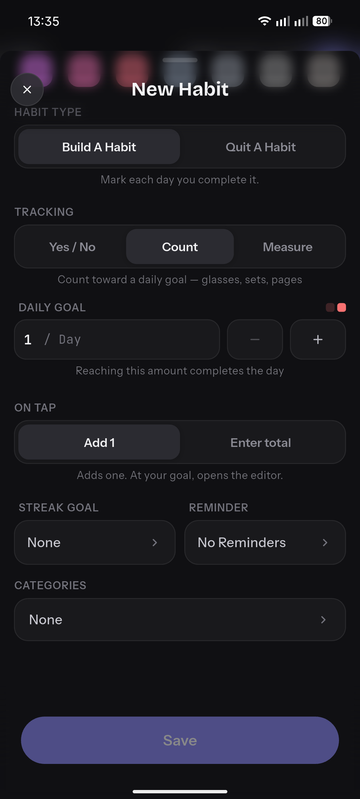
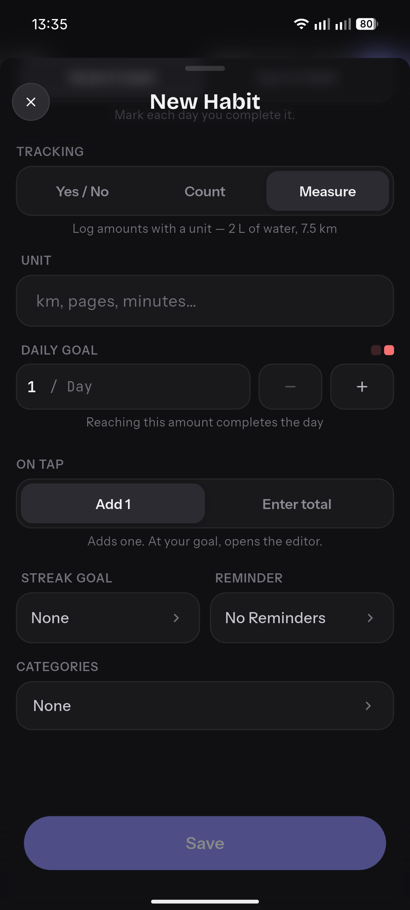
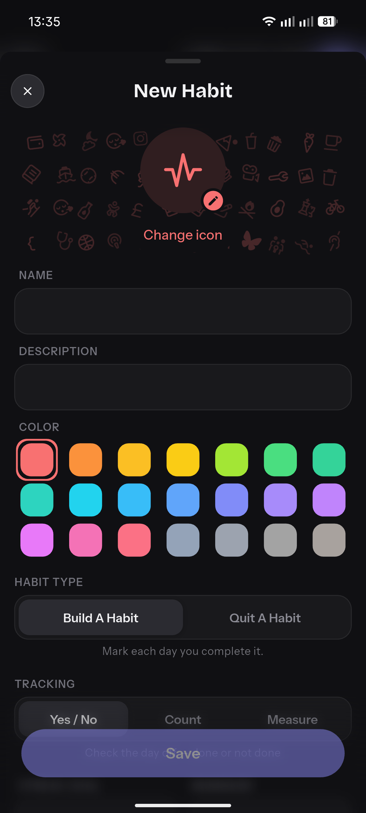
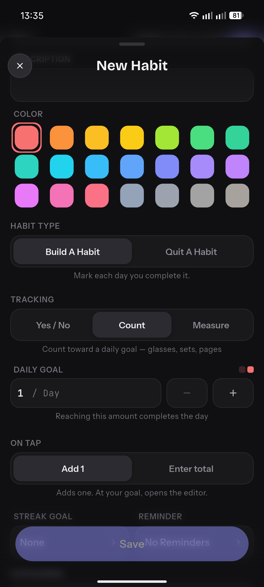

# UI References

This directory contains UI references for the HabitCents project.

## Habit Creation Screen
The following images capture the "New Habit" creation flow from a reference habit-tracking app.

- : Build/Quit toggle, Yes/No/Count/Measure tracking selection.
- : Detailed Measure tracking config (unit, goal, tap behavior).
- : Icon and color selection grid.
- : Count tracking config and additional settings (streak, reminders).
